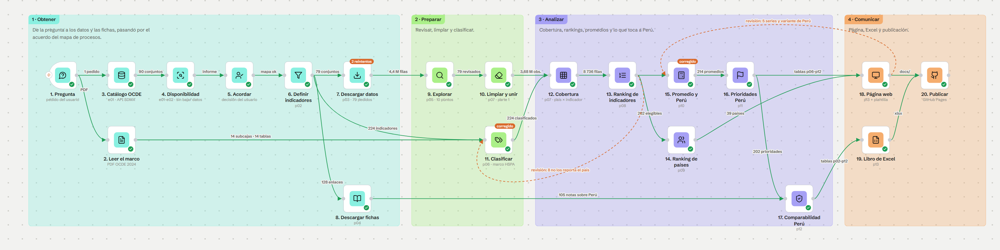

# Indicadores de salud de la OCDE

Qué mide la OCDE en cada parte de su marco de desempeño de los sistemas de salud, qué tanto lo reportan sus 38 miembros y dónde está Perú, país en proceso de adhesión.

**Página con los resultados:** https://diegosimemirror.github.io/oecd_health_ind/
**Pipeline de trabajo (estilo n8n):** https://diegosimemirror.github.io/oecd_health_ind/pipeline.html

[](https://diegosimemirror.github.io/oecd_health_ind/pipeline.html)

## Pregunta y destinatario

- **Tipo:** responder una pregunta que sirve para informar una decisión. Perú está en proceso de adhesión a la OCDE y debe decidir qué medir primero y qué medir mejor para poder compararse.
- **Preguntas:**
  1. ¿Dónde se ubica cada indicador de salud de la OCDE dentro del marco renovado de evaluación del desempeño (OCDE, 2024, figura de la p. 8)?
  2. ¿Cuál es el promedio OCDE de cada indicador, por parte del sistema? ¿Tiene Perú ese indicador?
  3. ¿Qué indicadores reportan al día la mayoría de los miembros y cuáles casi nadie? Como reportar no es obligatorio, esto muestra qué priorizan.
  4. ¿Qué países reportan más indicadores y cuáles menos?

## Resultados principales

| Hallazgo | Cifra |
|---|---|
| Indicadores en el tema Salud del OECD Data Explorer | 224, en 79 conjuntos de datos |
| Indicadores que dependen de que el país decida reportarlos (elegibles) | 202. Los otros 22 son estimaciones de la OCDE u otros organismos (21) o una serie reemplazada (1) |
| Al día en 90 % o más de los miembros | 35 |
| Al día en 60 a 89 % | 49 |
| Al día en 30 a 59 % | 64 |
| Al día en menos de 30 % | 54 |
| Caja más reportada (promedio de miembros al día) | Fuerza laboral 84 %, salud individual y poblacional 79 %, tecnologías y farmacéuticos 77 % |
| Caja menos reportada | Necesidades y preferencias (experiencia de pacientes) 20 %, calidad 44 % |
| Subcajas del marco sin indicadores en el tema Salud | Social y demográfico, datos y digital, conocimiento e innovación |
| Países que más reportan (de 202) | Países Bajos 159, Eslovenia 158, Canadá 158 |
| Países que menos reportan | Colombia 51, México 66, Costa Rica 66 |
| Perú | 78 al día (38,6 %); quedaría en el puesto 34 de 39, por encima de Nueva Zelanda, Estados Unidos, Costa Rica, México y Colombia |
| Prioridades para Perú | 31 por empezar a medir, 1 por actualizar, 13 por alinear su definición, 47 por evaluar, 45 de baja prioridad y 65 al día |

## Fuente

- **Datos:** OECD Data Explorer, tema *Health*: OECD Health Statistics 2026, indicadores de calidad (HCQO), PaRIS y la encuesta de características de los sistemas de salud (HSCS). Se descargaron por la API SDMX (`https://sdmx.oecd.org/public/rest`) el 16 y 17 de noviembre de 2026.
- **Fichas metodológicas:** los documentos «Definitions, Sources and Methods» de cada conjunto (78 fichas y 82 sub-fichas). Explican, país por país, la fuente y las diferencias con la definición OCDE. No se suben a este repositorio porque son documentos de la OCDE; `4_salidas/tablas/p04_indice_fichas.csv` y `p04_indice_subfichas.csv` tienen sus enlaces.
- **Marco:** OCDE (2024), *Rethinking Health System Performance Assessment: A Renewed Framework*, https://doi.org/10.1787/107182c8-en

## Carpetas

```
1_datos_crudos/        datos tal como los entrega la OCDE (no se modifican)
  catalogo/            catálogo de conjuntos y esquema de temas (XML)
  disponibilidad/      qué indicadores, países y años tiene cada conjunto (XML)
  datos/               un CSV comprimido por conjunto (79)
3_codigo/              scripts en Python, numerados según el mapa de procesos
  00_exploracion/      exploración inicial del catálogo
  plantilla_pagina.html    diseño de la página de resultados
  plantilla_pipeline.html  diagrama del pipeline (estilo n8n)
4_salidas/
  exploracion/         tablas de la exploración inicial
  tablas/              resultado de cada proceso (p02_... a p12_...)
  indicadores_ocde_salud.xlsx   todas las tablas en un libro de Excel
docs/                  la página web (GitHub Pages) y sus descargas
```

## Cómo reproducirlo

Requiere Python 3 con `pandas`, `requests`, `pymupdf`, `openpyxl` y `pyarrow` (todos vienen con Anaconda). Desde la carpeta del proyecto, ejecuta los scripts en orden:

```bash
python 3_codigo/00_exploracion/e01_catalogo_y_disponibilidad.py .
python 3_codigo/00_exploracion/e02_resumir_disponibilidad.py .
python 3_codigo/p02_definir_indicadores.py
python 3_codigo/p03_descargar_datos.py        # unos minutos; la API de la OCDE limita la velocidad
python 3_codigo/p04_descargar_fichas.py
python 3_codigo/p05_explorar_datos.py
python 3_codigo/p06_clasificar_marco.py
python 3_codigo/p07_cobertura.py
python 3_codigo/p08_ranking_indicadores.py
python 3_codigo/p09_ranking_paises.py
python 3_codigo/p10_promedios.py
python 3_codigo/p11_prioridades_peru.py
python 3_codigo/p12_comparabilidad_peru.py
python 3_codigo/p13_construir_pagina.py
```

## Mapa de procesos ejecutado

| N.º | Proceso | Insumo | Método | Resultado |
|---|---|---|---|---|
| 1 | Catálogo y disponibilidad | API de la OCDE | Listar los conjuntos del tema Salud y pedir su disponibilidad (sin bajar datos) | 90 conjuntos, 35,4 M de observaciones en total |
| 2 | Definir indicadores | Catálogo | Quitar 7 vistas resumen y 4 conjuntos regionales; indicador = conjunto × medida; HSCS = 1 por ronda | 224 indicadores en 79 conjuntos |
| 3 | Descargar datos | API | Un CSV comprimido por conjunto; gasto (SHA) y exposición ambiental filtrados a su serie principal | 79 archivos, 4,4 M de filas, 25 MB |
| 4 | Descargar fichas | Enlaces de cada conjunto | Bajar PDF y Excel, más las sub-fichas enlazadas dentro de ellos | 78 fichas + 82 sub-fichas (3 de la HSCS antigua ya no existen en el servidor) |
| 5 | Explorar | Datos descargados | Lista de 10 puntos | Sin duplicados ni archivos dañados; 15 642 filas sin valor (10 000 son preguntas no respondidas de la HSCS); negativos y valores >100 explicados (intervalos de confianza, diferencias) |
| 6 | Clasificar en el marco | Indicadores + PDF | Caja principal, transversales, fuente de la asignación y tipo de fuente | `p06_clasificacion_marco.csv` |
| 7 | Cobertura país × indicador | Datos + clasificación | Último año, rezago y estado (al día si está a ≤2 años del dato más reciente del indicador) | 224 × 39 = 8 736 filas |
| 8 | Ranking de indicadores | Proceso 7 | % de miembros al día; nivel de priorización | 202 elegibles en 4 niveles |
| 9 | Ranking de países | Proceso 7 | N.º de indicadores elegibles al día | 38 miembros + Perú |
| 10 | Promedio OCDE y Perú | Datos | Una serie de referencia por indicador; promedio simple de miembros al día | Promedio para 214 indicadores; Perú en la misma serie para 74 y en otra variante para 13 |
| 11 | Prioridades para Perú | Procesos 8 y 10 | Reglas según % de miembros al día y situación de Perú | 202 indicadores con prioridad |
| 12 | Comparabilidad de Perú | Datos de Perú + fichas | Marcas de calidad del dato y notas de Perú en las fichas | 23 indicadores con alertas; 65 con fuente peruana declarada |
| 13 | Representación | Procesos 6 a 12 | Página web estilo Our World in Data, pipeline estilo n8n y Excel | `docs/index.html`, `docs/pipeline.html`, `indicadores_ocde_salud.xlsx` |
| 14 | Resumen final | Todo | Este README | — |

## Decisiones de preprocesamiento

| Decisión | Registros afectados | Por qué |
|---|---|---|
| Excluir 7 vistas resumen | 7 conjuntos | Repiten medidas que ya están en los conjuntos de detalle; se contarían dos veces |
| Excluir 4 conjuntos regionales | 4 conjuntos | Son datos dentro de cada país; la pregunta es por país |
| Filtrar el gasto en salud (SHA) a total de funciones y proveedores | ~13,1 M de observaciones no descargadas | Completo pesa unos 2 GB; el análisis usa el total |
| Filtrar la exposición ambiental a 38 miembros + Perú, ambos sexos y todas las edades | ~13,3 M no descargadas | Es una estimación del IHME; basta la serie principal |
| Quitar EM y MCVD19 del conjunto de mortalidad semanal | 220 657 filas | Ya están en sus propios conjuntos |
| Quitar filas sin valor | 15 642 filas | Vienen vacías desde la OCDE; no contienen información |
| Quitar límites de intervalos de confianza | 60 530 filas | No son el valor del indicador (explican los negativos y los valores >100) |
| Quitar países socios distintos de Perú | 426 467 filas | El análisis es sobre los 38 miembros, con Perú como referencia |
| Reclasificar disponibilidad de alimentos (FAO), ausentismo laboral y empleo en salud como «estimación o fuente internacional» | 8 indicadores | Las sub-fichas muestran que no los reporta el país; no reflejan su prioridad |
| Corregir a mano la serie de referencia | 5 indicadores | La regla automática elegía una categoría parcial (p. ej. solo enfermedades infecciosas en egresos) |

Los archivos de `1_datos_crudos/` no se modifican: todos los filtros se aplican sobre tablas de trabajo.

## Paquetes usados

Ninguno se instaló en este proyecto: todos venían con Anaconda o con Python.

| Paquete | Para qué se usó | Funciones principales |
|---|---|---|
| pandas | Tablas, uniones, tablas dinámicas, Excel y Parquet | `read_csv`, `merge`, `groupby().agg`, `crosstab`, `cut`, `to_excel`, `to_parquet` |
| requests | Pedir datos a la API y bajar las fichas | `get` |
| xml.etree.ElementTree (estándar) | Leer el catálogo y la disponibilidad (XML SDMX) | `parse`, `iter`, `find` |
| pymupdf | Leer el PDF del marco y las fichas; extraer enlaces | `open`, `get_text`, `get_links` |
| openpyxl | Escribir el Excel y leer las fichas en Excel | `load_workbook` (y a través de pandas) |
| pyarrow | Guardar la tabla de 3,7 M de observaciones en Parquet | a través de `pandas.to_parquet` |
| numpy | Conteos en la exploración | — |
| gzip, json, re, time, pathlib, urllib, shutil, glob (estándar) | Comprimir, convertir a JSON, buscar texto, pausas, rutas | — |

## Objetos principales creados

**Total de objetos principales: 41** (además de variables auxiliares dentro de funciones).

| Objeto | Tipo | Tamaño | Qué contiene | Proceso | ¿Final o intermedio? |
|---|---|---|---|---|---|
| conjuntos (e01) | tabla | 90 × 8 | Conjuntos del tema Salud con enlaces a fichas | 1 | Intermedio |
| resumen (e02) | tabla | 90 × 10 | Observaciones, años, países e indicadores por conjunto | 1 | Intermedio |
| indicadores (e02) | tabla | 1 553 × 4 | Medidas de cada conjunto según el catálogo | 1 | Intermedio |
| VISTAS_RESUMEN | diccionario | 7 | Conjuntos que repiten indicadores | 2 | Intermedio |
| conjuntos_seleccionados | tabla | 79 × 9 | Conjuntos que se analizan | 2 | Intermedio |
| indicadores | tabla | 224 × 7 | Indicadores (conjunto × medida) | 2 | Intermedio |
| FILTROS | diccionario | 2 | Filtros de SHA y exposición ambiental | 3 | Intermedio |
| clave_filtro | función | — | Arma la clave SDMX de un conjunto | 3 | Intermedio |
| descargar | función | — | Baja una URL con reintentos y la comprime | 3 | Intermedio |
| registro (p03) | tabla | 79 × 5 | Resultado de cada descarga | 3 | Intermedio |
| enlaces | tabla | 128 × 5 | Enlaces metodológicos por conjunto | 4 | Intermedio |
| subfichas | tabla | 82 × 4 | Sub-fichas enlazadas dentro de las fichas | 4 | Intermedio |
| leer_conjunto | función | — | Lee un CSV comprimido sin deformar códigos | 5 | Intermedio |
| exploracion | tabla | 79 × 23 | Las 10 revisiones por conjunto | 5 | Final (informe) |
| marcas (p05) | tabla | 311 × 3 | Frecuencia de marcas de calidad (OBS_STATUS) | 5 | Intermedio |
| unidades | tabla | 346 × 4 | Unidades por medida y n.º de países | 5 | Intermedio |
| CAJA_DE_SUBCAJA | diccionario | 14 | Subcajas del marco y su caja | 6 | Intermedio |
| ASIGNACION | diccionario | 224 | Nombre en español, subcaja, transversales y fuente de cada indicador | 6 | Intermedio |
| ESTIMACIONES | diccionario | 12 | Conjuntos o medidas que no reporta el país | 6 | Intermedio |
| tipo_fuente | función | — | Clasifica quién produce el dato | 6 | Intermedio |
| clasificacion | tabla | 224 × 14 | Indicadores ubicados en el marco | 6 | Final |
| observaciones | tabla | 3 680 175 × 9 | Observaciones válidas de los 38 miembros + Perú | 7 | Intermedio |
| registro (p07) | tabla | 79 × 7 | Filas descargadas y excluidas por motivo | 7 | Final |
| frontera | tabla | 224 × 3 | Año más reciente de cada indicador y si la serie es vigente | 7 | Intermedio |
| cobertura | tabla | 8 736 × 10 | Último año, rezago y estado por país e indicador | 7 | Final |
| ranking (p08) | tabla | 224 × 19 | % de miembros al día y nivel de priorización | 8 | Final |
| resumen_caja | tabla | 9 × 7 | Promedio de cobertura por subcaja | 8 | Final |
| paises | tabla | 39 × 9 | Indicadores al día por país | 9 | Final |
| por_subcaja | tabla | 351 × 4 | País × subcaja: % al día | 9 | Final |
| por_defecto | diccionario | ~90 | Selección por defecto de la OCDE por conjunto | 10 | Intermedio |
| AJUSTES | diccionario | 5 | Correcciones manuales de la serie de referencia | 10 | Intermedio |
| elegir_serie | función | — | Elige la serie comparable de un indicador | 10 | Intermedio |
| variante_peru | función | — | Busca la variante de Perú más parecida | 10 | Intermedio |
| promedios | tabla | 224 × 20 | Promedio OCDE, valor de Perú y variante | 10 | Final |
| prioridades | tabla | 202 × 27 | Prioridad de medición para Perú | 11 | Final |
| comparabilidad | tabla | 79 × 15 | Marcas de calidad y fuente de Perú | 12 | Final |
| notas | tabla | 105 × 4 | Extractos de fichas sobre Perú | 12 | Final |
| UNIDADES / ALINEAR | diccionarios | 66 / 14 | Unidades y diferencias de Perú en español | 13 | Intermedio |
| ind | tabla | 224 × 38 | Todo lo que muestra la página, por indicador | 13 | Final |
| index.html | página web | 1 archivo | Resultados interactivos | 13 | Final |
| pipeline.html | página web | 20 nodos, 26 cables | Cómo se hizo el trabajo, estilo n8n (desde `3_codigo/plantilla_pipeline.html`) | 13 | Final |

## Limitaciones y pendientes

- **Al día no es lo mismo que comparable.** Las fichas detallan las diferencias de cada país; la sección 4 de la página resume las de Perú.
- **Tres subcajas sin indicadores** (social y demográfico, datos y digital, conocimiento e innovación). Hay datos afines en otros temas de la OCDE (población, gobierno digital, I+D) que este análisis no incluye. **Pendiente:** sumarlos.
- **El conteo da el mismo peso a todos los indicadores.** Calidad (88 medidas) pesa más que gasto (5 medidas, aunque el gasto tiene muchas desagregaciones). **Pendiente:** un conteo ponderado por conjunto.
- **La serie de referencia del promedio es una elección.** Se usó la que la OCDE muestra por defecto y se revisaron las 224 una por una, pero otro analista podría elegir otra (por ejemplo, cataratas como procedimiento de referencia).
- **Promedio simple.** No pondera por población.
- **Los datos de Perú vienen de la revisión de adhesión.** Algunos son estimados o tienen definiciones propias.

## Licencia

El código y las tablas propias están bajo la licencia MIT (ver `LICENSE`). Los datos descargados en `1_datos_crudos/` son de la OCDE y se rigen por sus términos de uso: https://www.oecd.org/en/about/terms-conditions.html
